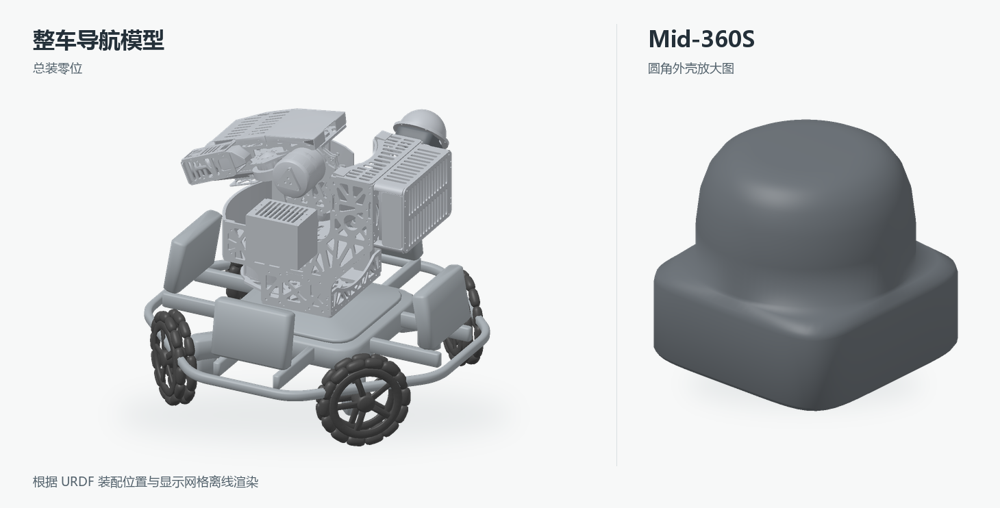

# RoboVigor_WS

工程结构、各包职责和搭建顺序见 [目录与搭建思路](TREE.md)。

ROS 2 哨兵导航工程，工作空间位于 `sentry_ws/`。
工程共 13 个 ROS 包，按模型、感知、定位、导航、决策与硬件通信分工，Python 代码使用 `src/包名/` 布局。
Gazebo 的底盘和云台原生插件使用 C++，其余现有程序和启动文件使用 Python。

## 当前功能

目前有场地、机器人模型、普通键盘遥控、Gazebo 驱动、仿真雷达和点云转扫描。
实体 Odin 驱动启动入口与地图服务客户端已有代码，需要厂家驱动及设备联调。
Nav2、决策行为树、裁判协议和实车底盘通信目前为包骨架，后续逐项填写。

## 哨兵导航模型

底盘使用圆角护板和四个全向轮。Mid-360S 与 Odin1 Lite 都安装在大 yaw 上，单独转动小 yaw 时，两台雷达的朝向保持不变。下图用工程内的 URDF 和显示网格离线渲染。



RViz 的整车视图默认显示四个轮心、转台、两台雷达和感知相机光学系的坐标轴。Odin1 Lite 上默认仅显示点云扫描轴 `odin1_lite_link`。前相机的局部坐标可在独立窗口查看。[车体与镜头坐标说明](sentry_ws/src/sentry_description/README.md) · [TF 树与发布者](sentry_ws/docs/frames_and_time.md)

## 在 Ubuntu 中构建和启动

目标环境为 Ubuntu 22.04、ROS 2 Humble、Gazebo Classic 11。
将工程放入 Ubuntu 后，在已安装并初始化 ROS 和 rosdep 的环境中执行。

```bash
cd ~/RoboVigor_WS/sentry_ws
source /opt/ros/humble/setup.bash
rosdep install --from-paths src --ignore-src -r -y
colcon build --symlink-install --base-paths src
source install/setup.bash
ros2 launch sentry_bringup sentry_sim_teleop.launch.py
```

联合启动默认打开 Gazebo、RViz 和键盘窗口。先点击键盘窗口，W/S 前后移动，A/D 左右平移，Q/E 转向，X 开启小陀螺，C 或空格全停。
默认速度参数和按键说明见 [手动控制](sentry_ws/src/sentry_motion/README.md)。

```bash
# 单独加载场地
ros2 launch sentry_map sentry_map.launch.py
# 查看机器人模型
ros2 launch sentry_description sentry_description.launch.py
# 同时查看整车和镜头坐标，可用滑块逐个转动车轮
ros2 launch sentry_description sentry_description.launch.py joint_gui:=true camera_view:=true
# 仿真中关闭键盘输入
ros2 launch sentry_bringup sentry_sim_teleop.launch.py keyboard:=false
```

包职责、接口和后续填写顺序见 [工作空间说明](sentry_ws/README.md)。
这次目录调整后还需要在 Ubuntu 中编译，检查 Qt 窗口、Gazebo 运行和停车行为。实车总启动、完整建图定位和自动导航尚未完成。
